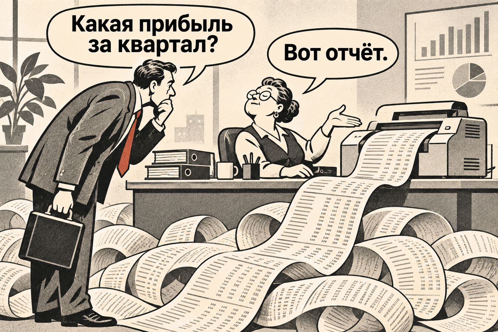

# P02. Авторский черновик

## Сведения

- Авторская версия от 18 ноября 2026 года.
- [Карточка P02](../briefs/P02-work-left-in-the-head.md) и [разбор с примерами и источниками](../briefs/P02-pain-first.md).
- Сведения о публикации не указаны.
- Для анализа стиля использовать собственные формулировки автора. Первый тезис сформулирован в обсуждении, а описание бюллетеня в Палм-Бич взято из исследовательской заготовки.

## Иллюстрация

## Текст автора

**Можно дать человеку все нужные данные и оставить не решенной задачу, с которой он пришёл.**

Еще продуктовых проблем в студию — это когда вы думаете что делаете классный продукт или автоматизацию, а по факту система вываливает на пользователя ворох данных, которые еще нужно собрать самому в осмысленный ответ на первоначальный вопрос.

Например:

- Финансовый анализ для C-level VS километры бухгалтерской отчетности (считай сам!)
- Подбор билетов на рейсы со стыковками VS сырой каталог отдельных билетов "собери сам"
- Функции Google Calendar для планирования совместных встреч с учетом занятости каждого участника VS "вот тебе отдельные календари, своди все сам"
- Интернет магазин: у вас есть склад по артикулам и количеству, а покупатель заинтересован в готовых наборах. Придется считать доступность наборов как для отдельной сущности, иначе это не продукт а фикция.

Причем исторически есть казусы буквально показывающие критичность самого визуального интерфейса. **Бюллетень-«бабочка», Палм-Бич, 2000 год.** Имена кандидатов напечатали на двух страницах, отверстия для отметок разместили между ними. Эл Гор стоял вторым слева, но второе отверстие относилось к Пэту Бьюкенену справа. Избирателю приходилось вести взгляд по стрелке через страницу. Комиссия США по гражданским правам приводит свидетельство избирательницы, которая пробила именно это отверстие по ошибке.

И цена ошибки в таких системах может быть астрономической. В случае с выборами — это больше скандал. Но кейс Southwest Airlines, декабрь 2022 года, показывает совсем неприятный сценарий приведший к 16900 отмененных рейсов — зимний шторм запустил волну отмен, для восстановления расписания нужно было заново сопоставить рейсы, но ручная сборка усложнила процесс в ситуации когда реакция должны была быть моментальной.

Мне еще кажется любопытным то, что этот паттерн довольно устойчив. Довольно часто команды разработки дают строительные блоки, хотя задача клиента уже известна и нужно сделать всего один шаг чтобы увидеть что решения для нее все еще не предоставляется.

И на последок самый надоедливый пример — тротуары. Те самые, которые кладут не там где люди будут ходить. В итоге получаются протоптанные газоны. Зато городские службы могут отчитаться о километрах укладки пешеходных дорожек.